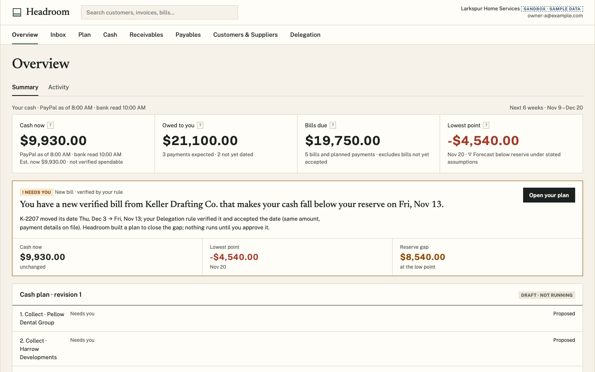
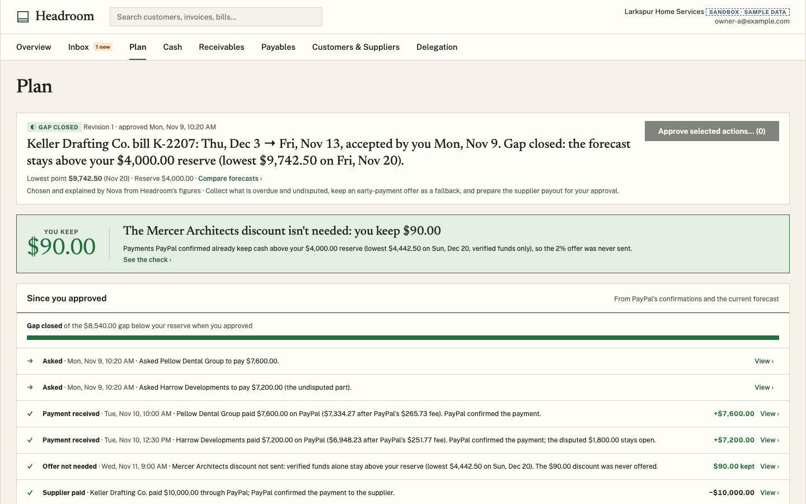
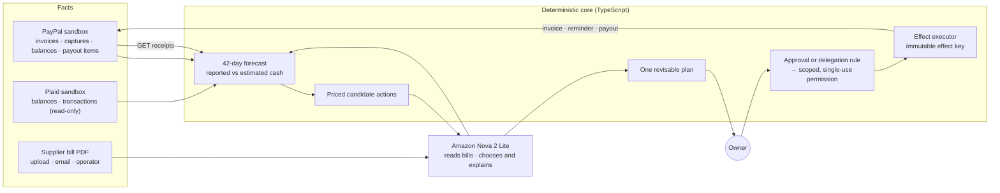

# Headroom — a cash-reserve guard for small service businesses on PayPal

On a Monday morning Larkspur Home Services, a small services firm, has $9,930
in cash, $21,100 owed by three customers, and a $4,000 reserve the owner never
wants to dip below. Then Keller Drafting Co.'s bill K-2207 arrives. It's for
the same $10,000 as before, but now it's due Fri, Nov 13 instead of Thu, Dec 3.
No single screen looks wrong. Headroom re-runs the 42-day forecast and finds
cash falling to **−$4,540 on Nov 20, $8,540 below the reserve**.

Headroom answers the question "am I OK, and what needs me?" for an owner who
isn't an accountant. It explains why the breach is coming and proposes a dated
plan in which every number cites its source:

- ask Pellow Dental Group to pay its overdue $7,600;
- ask Harrow Developments for the $7,200 undisputed part of an invoice with
  $1,800 in dispute;
- schedule a 2% early-payment offer to Mercer Architects as a fallback;
- hold Keller's $10,000 payout for the owner's approval.

The owner edits, removes or approves. Both customers pay on PayPal's hosted
checkout, and Headroom counts each payment only once PayPal reports the capture
`COMPLETED`, with gross, fee and net ($7,600 → $7,334.27 after a $265.73 fee).
Verified funds now keep the forecast above the reserve, so the Mercer offer is
never sent and the business keeps $90. On Nov 13 the Keller payout runs through
PayPal Payouts, and only because the PayPal balance itself can fund it. The bill
is marked paid when PayPal reports the payout item `SUCCESS`.





## Video

[Watch Headroom on YouTube](https://youtu.be/ioCN48UEYNM)

## How it works



**Facts.** PayPal is where customer money arrives and supplier money leaves, so
its reads establish what is real: invoice and capture GETs, the balances and
transactions report with its as-of time, and payout-item GETs. Plaid adds
read-only bank balances and transactions so the company cash picture is
complete. A supplier bill enters as its original PDF and is stored write-once.
Nova reads it as quoted text, and the owner (or the owner's rule) verifies and
accepts the change.

**Forecast.** Deterministic code builds a 42-day forecast in integer minor units.
"Cash now" is kept honest: PayPal's last report, the estimate since then, and
captured money awaiting PayPal's report are shown separately, never merged.

**Plan.** Code turns the breach into fully priced candidate actions (collect,
remind, offer a discount, pay a supplier). Nova only chooses among those
candidates and explains its choice, citing them. Its output is checked against
a schema and the citation rules; if it fails twice, Headroom's template writes
the plan, and the plan says so on screen.

**Authority.** Approving a plan, or a delegation rule the owner set, becomes a
permission scoped to one action, its amount, recipient and window. Pauses stop
outreach or payments at once.

**Execution and proof.** Durable leased jobs run each action through one effect
executor. It re-checks authority and funds when the action runs, and writes to
PayPal under an immutable effect key. A timeout becomes `UNKNOWN` and is
reconciled with the same key, never retried under a new one. Webhooks are
hints: the signature is verified, the raw body is stored, and the resource is
fetched. Each PayPal result re-enters as versioned state, which changes the
forecast and the actions still pending.

On AWS it is a modular monolith: CloudFront and S3 serve the React app, an API
Gateway HTTP API with a Cognito JWT authorizer fronts the `api` and `webhook`
Lambdas, and `worker`, `sweep`, `operator` and `payer` Lambdas run the jobs.
State lives in four DynamoDB tables (core, work, audit, provider), with an SQS
work queue, an EventBridge sweep every minute, an S3 evidence bucket, KMS for
Plaid tokens and Secrets Manager for provider credentials. Locally, a single
Node process runs the same router, domain code and job worker against an
in-memory store.

## Run locally

### Prerequisites

- Node.js **22.x** (`.nvmrc`; verified on 22.23.3 with npm 10.9.9) and Git, on
  macOS or Linux.
- Free ports `5173` (web) and, for live mode, `8787` (local API; the web dev
  server proxies `/v1` there).
- For the browser tests: a Chromium that `playwright-core` can launch
  (`npx playwright-core install chromium`, a few hundred MB on disk, or set
  `CHROMIUM_PATH`).
- For live mode only: a PayPal Developer account with a sandbox REST app.
  Plaid sandbox keys and AWS credentials with Bedrock access are optional.

### Install

```bash
git clone https://github.com/markbrazinski/paypal-headroom.git
cd paypal-headroom
npm ci
```

```text
added 162 packages, and audited 188 packages in 3s
```

The fastest proof the code works needs no configuration and no credentials:

```bash
npm run typecheck
npm test
npm run test:acceptance
```

```text
ℹ tests 186
ℹ pass 186
ℹ fail 0
...
ℹ tests 250
ℹ pass 250
ℹ fail 0
```

The unit suite covers arithmetic, state machines, gates and adapters. The
acceptance suite runs the real router, domain code and persistence against
PayPal, Plaid and model adapters that replay recorded sandbox responses
(`tests/fixtures/`). That keeps every scenario repeatable, refusals and races
included.

### Try it: the recorded journey, no credentials

```bash
npm run dev -w web
```

```text
  VITE v6.4.5  ready in 128 ms
  ➜  Local:   http://localhost:5173/
```

Open [http://localhost:5173/?demo=1](http://localhost:5173/?demo=1). The whole
journey above was recorded from the real router and domain code, with Nova on
Bedrock reading the bill and writing the plan. It replays in your browser from
`web/public/golden/`, with no server and no PayPal call. A dock in the bottom
left walks through eight steps:

1. A healthy-looking cash position.
2. A supplier bill arrives. Your move: open the plan and press **Approve**, or
   choose **Approve for me**.
3. Plan approved.
4. Headroom asks.
5. Pellow Dental Group pays.
6. Harrow pays the undisputed part.
7. The discount isn't needed.
8. Keller is paid.

Every screen (Overview, Inbox, Plan, Cash, Receivables, Payables, Customers &
Suppliers, Delegation) shows that step's data.

| Key | Action |
|---|---|
| `]` / `[` | next / previous step |
| `H` | hide or show the dock |
| `?demo=1&step=N` | jump to step N (0–7) |
| `?demo=0` | leave the recording |

### Browser tests

The payout and delegation suites drive the real built app in headless Chromium against a
replay server. That server wires the real router to the acceptance harness and
recorded PayPal responses, so runs are repeatable and never move money.

```bash
npx playwright-core install chromium
npm run build
node scripts/verify/s7-replay-server.ts &
node scripts/verify/browser-s7.mjs --out /tmp/headroom-s7
node scripts/verify/s6-replay-server.ts &
node scripts/verify/browser-s6.mjs --out /tmp/headroom-s6
kill %1 %2
```

```text
REPLAY delegation server on http://127.0.0.1:8797 · scenarios: hero, dispute, ask · ...
48/48 checks passed · evidence /tmp/headroom-s7
REPLAY payout server on http://127.0.0.1:8796 · scenarios: held, unconfirmed, waiting, paid, ...
34/34 checks passed · evidence /tmp/headroom-s6
```

Each run writes `results.json` and screenshots at 1440×900 and 1280×800 to
`--out`. To rerun one scenario, add `--only B3`; to rerun just the failures of
an earlier run, add `--failed <dir>`.

### Live mode on the PayPal sandbox

This mode issues real PayPal **sandbox** invoices, reads real sandbox balances
and, with Plaid keys, links a Plaid sandbox bank. The PayPal adapter refuses any
non-sandbox URL.

1. In the [PayPal Developer Dashboard](https://developer.paypal.com/dashboard/applications/sandbox),
   create a sandbox REST app. Note its client id and secret, and the email of
   the sandbox business account that owns it.
2. Create `.env` and fill in `PAYPAL_CLIENT_ID`, `PAYPAL_CLIENT_SECRET` and
   `PAYPAL_MERCHANT_EMAIL`:

   ```bash
   cp .env.example .env
   ```

   [`.env.example`](.env.example) documents every variable. The defaults it
   sets are `HEADROOM_GRANT=SANDBOX`, the provider call budget; without it,
   every PayPal and Plaid call is refused. They also include
   `MAIL_CHANNEL=simulated`, a labelled in-app mailbox, so no email leaves
   Headroom.
3. Start the API and the web app:

   ```bash
   npm run dev
   ```

   ```text
   No run yet: start one with `npm run reset -- --stage local`
   Headroom local API on http://127.0.0.1:8787 (STAGE=local, PayPal grant SANDBOX, model NOT CONFIGURED)
     ➜  Local:   http://localhost:5173/
   ```

4. In a second terminal, start a fresh run of the sample business. This issues
   three sandbox invoices and, with Plaid keys, seeds a sandbox bank:

   ```bash
   npm run reset -- --stage local
   ```

   It prints the run as JSON, ending with `"state": "READY"`, and exits 0. It
   took about 13 s in testing.
5. Health check:

   ```bash
   curl -s http://127.0.0.1:8787/v1/session
   ```

   ```text
   {"tenantName":"Larkspur Home Services","timeZone":"America/New_York",...,"run":{"runId":"run-22f9ua","epoch":1,"state":"READY","seeded":true},...}
   ```

6. Open [http://localhost:5173](http://localhost:5173). Set
   `HEADROOM_LOCAL_ROLE=OPERATOR` in `.env` and restart to get the
   **Sandbox controls** drawer: **Bring in Keller's bill**, **Advance to next
   step**, **Pay on PayPal**, and **Refresh from PayPal and the bank**. Verify
   and accept the bill in Payables, then open the Plan and approve it.

**Optional: Amazon Nova.** Set `HEADROOM_MODEL=us.amazon.nova-2-lite-v1:0`, and
make AWS credentials with `bedrock:InvokeModel` available through the standard
chain (`AWS_PROFILE`, SSO or environment). The permission must cover the US
cross-region inference profile and the Nova 2 Lite foundation model in
`us-east-1`. Nova then reads the original bill and chooses and explains the
plan. A bill read and a plan take a handful of small Nova 2 Lite calls; a whole
journey costs a few cents. Without a model, bills show "Model not configured
here" and the plan uses Headroom's template.

**Optional: customers paying.** With a sandbox personal account in
`PAYPAL_PAYER_EMAIL` and `PAYPAL_PAYER_PASSWORD`, **Pay on PayPal** completes
PayPal's hosted checkout in the local Google Chrome, as a labelled automated
payer. You can also pay the sandbox invoice yourself from that account. Either
way, the receipt comes only from PayPal's invoice and capture GETs. Supplier
payouts go to the sandbox receiver in `PAYPAL_BUYER_EMAIL`.

### Troubleshooting

- `ENOENT ... .env`: live mode reads `.env`. Run `cp .env.example .env`. The
  recorded journey and the tests need no `.env`.
- `PayPal credentials missing` or `PAYPAL_ENV must be sandbox`: fill
  `PAYPAL_CLIENT_ID` and `PAYPAL_CLIENT_SECRET`, and keep
  `PAYPAL_ENV=sandbox`.
- The run comes up `BLOCKED` with "No PayPal grant configured
  (HEADROOM_GRANT)": set `HEADROOM_GRANT=SANDBOX`. Budgets expire on
  2026-12-31; to extend them, set `HEADROOM_GRANT_EXPIRES_AT` to an ISO UTC
  instant.
- `RUN_SEALED` / "No active run": run `npm run reset -- --stage local`.
- `EADDRINUSE 127.0.0.1:8787` (or `8796` / `8797` for the replay servers):
  another process holds the port. Stop it (`lsof -nP -iTCP:8787
  -sTCP:LISTEN`). The web dev server always proxies to `8787`.
- `browserType.launch: Executable doesn't exist`: run
  `npx playwright-core install chromium`, or point `CHROMIUM_PATH` at a
  Chromium or Chrome binary.
- `npm warn EBADENGINE`: switch to Node 22 (`nvm use`).

### Shutdown

Press Ctrl-C in the `npm run dev` or `npm run dev -w web` terminal; one Ctrl-C
stops both the API and Vite. Local state lives in `.headroom-local/`: the
store, the local vault key, the operator token and stored bill originals.
Delete that folder for a clean slate. Sandbox invoices stay on your PayPal
sandbox merchant.

## Deploy

The CDK app in `infra/` defines two sandbox stages, `HeadroomDev`
and `HeadroomReview`, in `us-east-1`. You need an AWS account
CDK-bootstrapped in `us-east-1`, Bedrock access to Nova 2 Lite, and credentials
in `AWS_PROFILE`. The operator scripts default `AWS_PROFILE` to
`headroom-admin`; set yours.

To check that the app synthesizes, with no account:

```bash
cd infra
CDK_DEFAULT_ACCOUNT=123456789012 npx cdk synth --quiet
```

```text
Successfully synthesized to .../cdk.out
Supply a stack id (HeadroomDev, HeadroomReview) to display its template.
```

To deploy and set up a stage:

```bash
npm run build
cd infra && npx cdk deploy HeadroomDev && cd ..
node scripts/dev/setup.ts all --stage dev
```

`setup.ts all` does the following:

- copies the PayPal and Plaid sandbox credentials from `.env` into Secrets
  Manager (values are never printed);
- creates the Cognito users (passwords go to `.headroom-local/dev-users.json`);
- bootstraps the tenant;
- registers the PayPal sandbox webhook;
- stores the sandbox payer login.

The review stage uses a second sandbox merchant (`PAYPAL_REVIEW_*`), one
operator and judge accounts in Cognito groups. The `operator` Lambda resets
runs: `npm run reset -- --stage dev`.

[`docs/SETUP.md`](docs/SETUP.md) lists every setting, script and route.

## Technologies and dependencies

- **TypeScript 5.9.3 on Node.js 22** for every layer. Node runs the `.ts`
  sources directly with type stripping, so there is no build step for the
  backend.
- **PayPal REST APIs (sandbox)**: Invoicing v2 (create, send, full-replace update,
  search, GET), Payments v2 capture GETs, Reporting v1 balances and transactions,
  Payouts v1 with payout-item GETs, and webhook signature verification.
- **Plaid (sandbox)**: Link, `/transactions/sync`, `/accounts/balance/get`,
  `/item/get` and `/item/remove`. Read-only.
- **Amazon Bedrock, Nova 2 Lite** (`us.amazon.nova-2-lite-v1:0`) through
  Converse at temperature 0. It reads bills (EvidenceInterpreter), chooses and
  explains plan actions (RecoveryPlanner), writes greetings and closings
  (MessageDrafter), and reads email replies.
- **zod 4.6.7**: one route table and schema set in `contracts/`, shared by the
  API, the web client and the generated OpenAPI file.
- **React 18.3.1, Vite 6.4.5, AG Grid 33.3.2 and AG Charts 11.3.2** for the web
  app.
- **AWS CDK** (`aws-cdk-lib` 2.275.0, `aws-cdk` 2.1147.0, esbuild 0.25.12) and
  **AWS SDK for JavaScript v3** 3.1161.0: Lambda, API Gateway HTTP API,
  Cognito, DynamoDB, SQS, EventBridge, S3, KMS, Secrets Manager and
  CloudFront.
- **pdfjs-dist 6.4.299** extracts text from bill PDFs.
- **playwright-core 1.48.2** and **@sparticuz/chromium 130.0.0** drive the
  browser tests and the sandbox payer Lambda.
- **Gmail API** in test mode (optional). Every message goes to one test inbox.

## Repository structure

```text
contracts/              route table, DTO schemas and state machines shared by API and web; OpenAPI
backend/src/
  domain/               forecast, obligations, receivables, payables, plan, authority, executor, comms
  read/                 read models the screens render as given
  adapters/             PayPal, Plaid, Bedrock, Gmail, DynamoDB/memory store, SQS/memory queue, vault
  handlers/             API router, webhook, worker, sweep, operator and payer Lambdas, local server
  jobs/                 durable leased jobs and the sweep
web/src/                React app: Overview, Inbox, Plan, Cash, Receivables, Payables, Delegation
web/public/golden/      the recorded journey replayed at /?demo=1
infra/                  CDK stacks (dev, review) and the API role's grants as data
tests/acceptance/       end-to-end domain scenarios on recorded provider responses
tests/fixtures/         sanitized recorded PayPal, Plaid and model responses, sample bills
scripts/verify/         browser scenarios and replay servers
scripts/live/           sandbox and dev-stage journeys (need a deployed stage)
scripts/demo/           operator scripts: reset, bill, collect, status, recording
docs/                   SETUP reference and README images
```

## License

Apache-2.0. See [`LICENSE`](LICENSE).

## Scope

- **PayPal sandbox only.** The HTTP adapter refuses any URL that isn't
  PayPal's sandbox, and every provider call draws on a named budget with an
  expiry.
- **The model proposes; code decides.** Nova reads documents and chooses and
  explains among candidates Headroom has already priced. Amounts, dates,
  recipients, permissions and provider state come from deterministic code, and
  output that fails a schema or citation check is refused.
- **Money counts when PayPal says so.** A customer payment counts when its
  capture is `COMPLETED`, and a supplier is paid when its payout item is
  `SUCCESS`. Webhooks only prompt a GET.
- **One writer, one key.** Only the effect executor writes to providers. Each
  write has an immutable effect key, and an unknown outcome is reconciled
  under that key.
- **The bank is read-only.** Plaid makes the cash picture complete. Supplier
  payouts are funded from the PayPal balance.
- **Approval is a permission, not a flag.** It is scoped to one action, single
  use, re-checked at execution and revocable, with owner rules for what may
  run without asking.
- **Email goes to a test inbox.** Messages go through Gmail to one test inbox,
  or to a labelled in-app mailbox.
- **One business per sign-in.** Each Cognito user is bound to one tenant, and
  every read and write is scoped to it.
